# Habit & Study Tracker

Кроссплатформенное мобильное приложение на **Flutter/Dart** для отслеживания
привычек и учебных целей: серии (streaks), статистика, напоминания.

> Тема №3 курса «Разработка мобильных приложений на Flutter».

## Как посмотреть приложение

- **Android:** скачать `habit-study-tracker.apk` со страницы
  [Releases → последняя сборка](https://github.com/Nureke-Doer/Flutter/releases/latest)
  и установить на телефон.
- **В браузере:** https://nureke-doer.github.io/Flutter/
- Каждый пуш собирается автоматически: [GitHub Actions](https://github.com/Nureke-Doer/Flutter/actions)
  (анализ, тесты, APK, web).

## 1. Постановка задачи

### Цель

Помочь студентам и всем, кто учится самостоятельно, выработать полезные
привычки и регулярно заниматься учёбой. Приложение позволяет:

- создавать **привычки** («пить воду», «зарядка») и **учебные цели**
  («30 минут английского», «решить 5 задач по алгоритмам»);
- ежедневно отмечать выполнение одним нажатием;
- видеть **серию** — сколько дней подряд цель выполняется, и лучшую серию;
- смотреть **статистику** за неделю / месяц;
- получать **напоминания** в выбранное время;
- находить **учебные материалы** (книги) через открытый API и сохранять их.

### Целевая аудитория

- Студенты колледжей и вузов (17–25 лет), которым нужно систематически
  готовиться к занятиям и экзаменам.
- Школьники старших классов, готовящиеся к ЕНТ/IELTS.
- Люди, изучающие что-то самостоятельно (языки, программирование).

### Аналоги

| Приложение | Что нравится | Чего не хватает |
|---|---|---|
| **Loop Habit Tracker** | Простой, бесплатный, хорошая статистика | Нет учебных целей и материалов, устаревший дизайн |
| **Habitica** | Геймификация, сообщество | Перегружен интерфейс, сложен для новичка |
| **Forest** | Фокус на учёбе (таймер) | Нет привычек и серий по дням, платный |

**Отличие нашего приложения:** объединяет привычки и учебные цели в одном
месте и сразу подсказывает учебные материалы по теме цели.

### Список экранов

1. **Сегодня (Home)** — список привычек и целей на сегодня, отметка выполнения,
   прогресс дня, мотивационная цитата.
2. **Детали цели** — серия, лучшая серия, календарь выполнений за месяц.
3. **Создание / редактирование цели** — название, тип (привычка / учёба),
   иконка, цвет, дни недели, время напоминания.
4. **Статистика** — процент выполнения за неделю, график по дням,
   лидеры по сериям.
5. **Учебные материалы** — поиск книг через Open Library API,
   сохранение в «избранное».
6. **Карточка книги** — обложка, авторы, год, темы.
7. **Настройки** — тема (светлая / тёмная / системная), язык, уведомления.
8. **Вход / регистрация** — Firebase Authentication (неделя 8).
9. **Карта** — места для учёбы рядом (библиотеки, коворкинги) (неделя 9).

### MVP (минимально жизнеспособный продукт)

- [x] CRUD привычек и учебных целей
- [x] Отметка выполнения за день, подсчёт текущей и лучшей серии
- [x] Статистика за 7 дней
- [x] Поиск учебных материалов через REST API
- [x] Светлая / тёмная тема, хранение настроек
- [x] Офлайн-работа (локальная БД)
- [ ] Напоминания (push / локальные уведомления) — недели 8, 11

## 2. Как запустить

**Требования:** Flutter 3.32+ (Dart 3.8+), Android Studio или VS Code, эмулятор Android или телефон.

```bash
git clone https://github.com/Nureke-Doer/Flutter.git
cd Flutter
flutter doctor        # проверка окружения — не должно быть ошибок
flutter pub get       # установка зависимостей
flutter run           # запуск на эмуляторе / устройстве
```

Проверки качества:

```bash
flutter analyze                 # статический анализ — No issues found
flutter test                    # все тесты (93 шт.)
flutter test --coverage         # отчёт о покрытии в coverage/lcov.info (~87%)
dart format .                   # форматирование кода
```

Кодогенерация (нужна только при изменении моделей или текстов):

```bash
dart run build_runner build --delete-conflicting-outputs   # *.g.dart для JSON-моделей
flutter gen-l10n                                           # тексты из lib/l10n/*.arb
```

### Технологии

| Задача | Пакет |
|---|---|
| Состояние: основная логика | `flutter_bloc`, `bloc_concurrency`, `stream_transform` |
| Состояние: настройки | `provider` |
| DI | `get_it` |
| Сеть | `dio` |
| JSON | `json_annotation` + `json_serializable`, `build_runner` |
| Локальное хранение | `shared_preferences`, `hive_ce` |
| Сравнение объектов | `equatable` |
| Локализация | `flutter_localizations`, `intl` (ru / en) |
| Тесты | `flutter_test`, `bloc_test`, `mocktail` |

## 3. Задачи на Dart (неделя 1)

Папка [`dart_tasks/`](dart_tasks) — небольшие задачи по основам Dart:

| Файл | Тема |
|---|---|
| `task1_null_safety.dart` | null safety: `?`, `??`, `?.`, `!`, `late` |
| `task2_classes.dart` | классы, абстрактные классы, наследование, enum, mixin |
| `task3_collections.dart` | List, Set, Map, records, `map/where/fold`, подсчёт серии |
| `task4_async.dart` | `Future`, `async/await`, `Stream`, `Future.wait`, таймаут, ошибки |

Запуск: `dart run dart_tasks/task3_collections.dart`.
Тесты к задачам: `flutter test test/dart_tasks_test.dart`.

## 4. Неделя 2 — виджеты и UI

### Эскизы экранов

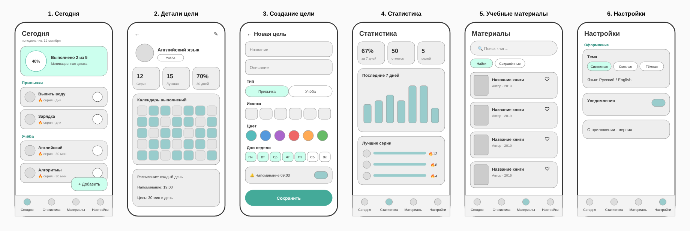

Исходник эскизов — [`docs/sketches/wireframes.svg`](docs/sketches/wireframes.svg).

### Скриншоты (статические данные)

| Сегодня | Детали | Статистика | Тёмная тема |
|---|---|---|---|
| 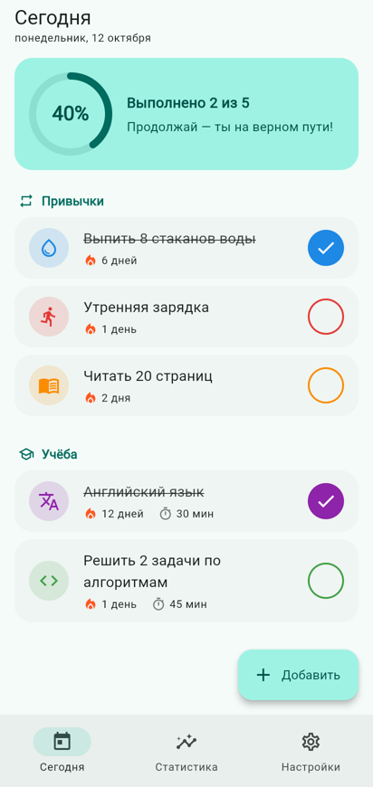 | 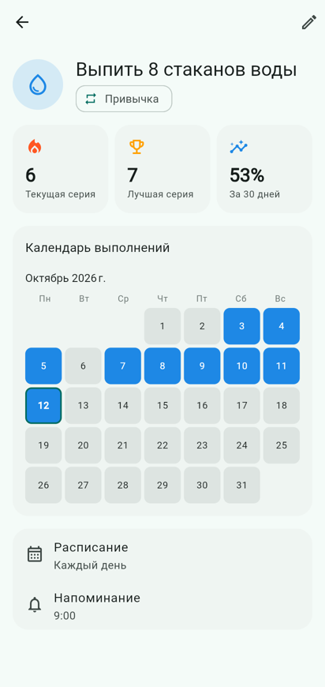 | 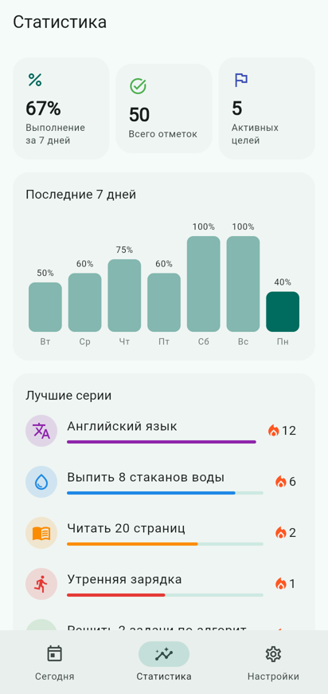 | 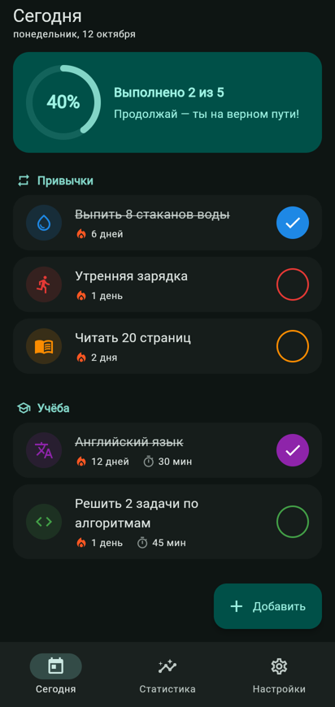 |

### Что сделано

- 5 экранов: **Сегодня**, **Детали цели**, **Создание цели**, **Статистика**, **Настройки**
  + нижняя навигация (`NavigationBar` + `IndexedStack`).
- `StatelessWidget` — экраны, которые только отображают данные
  (`TodayScreen`, `HabitDetailScreen`, `StatisticsScreen`).
- `StatefulWidget` — `HomeShell` (выбранная вкладка) и `HabitEditScreen` (состояние формы).
- Использованы `Row`, `Column`, `Stack` (круговой прогресс с процентом внутри),
  `ListView`, `GridView` (календарь), `Wrap`, `Card`, `ListTile`, `SegmentedButton`,
  `FilterChip`, `Slider`, `Switch`, `showTimePicker`, `AnimatedContainer`.
- Тема **Material 3** (`ColorScheme.fromSeed`), светлая и тёмная, переключается по системе.
- Локализация через `flutter gen-l10n` (ARB-файлы `lib/l10n/app_ru.arb`, `app_en.arb`),
  включая правильные формы множественного числа («1 день», «3 дня», «5 дней»).
- Модель `Habit` с логикой подсчёта серии, лучшей серии и процента выполнения + unit-тесты.

### Структура проекта (неделя 2, до разделения на слои)

```
lib/
├── main.dart              # точка входа
├── app.dart               # MaterialApp: темы, локализация
├── data/mock_habits.dart  # статические данные
├── l10n/                  # ARB-файлы и сгенерированная локализация
├── models/habit.dart      # модель привычки/учебной цели
├── screens/               # экраны
├── theme/app_theme.dart   # тема Material 3, отступы
├── utils/date_utils.dart  # работа с датами
└── widgets/               # переиспользуемые виджеты
```

## 5. Неделя 3 — управление состоянием (базовые подходы)

**Ключевая функция:** отметка выполнения за день, создание, редактирование
и удаление целей. Реализована трижды (отдельные коммиты):
`setState` → `InheritedWidget` → `Provider`.

Подробно с примерами кода: [`docs/week3_state_management.md`](docs/week3_state_management.md).

| | setState | InheritedWidget | Provider |
|---|---|---|---|
| Плюсы | Просто, встроено, нет зависимостей | Доступ из любого места дерева, встроено во Flutter | Мало кода, `watch/read/select`, логика отделена от UI и тестируется unit-тестами |
| Минусы | Prop drilling, дублирование копий данных, логика смешана с UI | Много шаблонного кода, легко ошибиться с подпиской | Внешняя зависимость; для сложной асинхронной логики не хватает структуры |
| Когда применять | Локальное состояние виджета (форма, вкладка, анимация) | Раздача редко меняющихся данных (как `Theme.of`) | Простое общее состояние: настройки, тема, избранное |

## 6. Неделя 4 — продвинутое управление состоянием и архитектура

### Архитектура по слоям

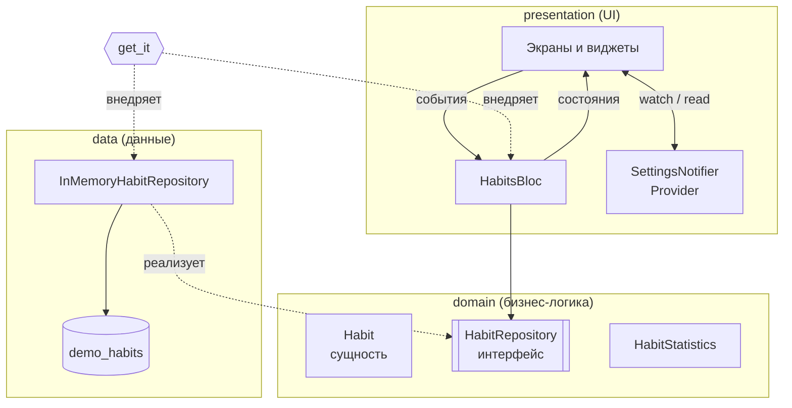

- **domain** — чистый Dart, не зависит от Flutter и от способа хранения:
  сущность `Habit` (подсчёт серий), интерфейс `HabitRepository`,
  сервис `HabitStatistics`.
- **data** — реализации репозиториев. Сейчас `InMemoryHabitRepository`;
  на неделе 6 появится реализация на Hive, а на неделе 8 — Firestore.
- **presentation** — экраны, виджеты, `HabitsBloc` и `SettingsNotifier`.
- **Dependency Injection** — `get_it` (`lib/core/di/injection.dart`).
  BLoC получает репозиторий через конструктор, поэтому в тестах вместо
  настоящего репозитория легко подставить мок (`mocktail`).

### Почему BLoC для основной логики, а Provider — для настроек

| Критерий | BLoC (`flutter_bloc`) | Provider (`ChangeNotifier`) |
|---|---|---|
| Где используется | Список целей, отметки, удаление/отмена, загрузка из репозитория | Тема и язык |
| Явные события | ✅ `HabitToggled`, `HabitSaved`, `HabitDeleted`… — видно, что может произойти | ❌ методы вызываются напрямую |
| Асинхронность и потоки | ✅ `emit.forEach` для `Stream` из репозитория, обработка ошибок | Нужно писать вручную |
| Состояния loading / success / failure | ✅ явный `HabitsStatus` | Флаги вручную |
| Тестирование | ✅ `bloc_test`: «событие → ожидаемые состояния» | ✅ unit-тесты, но без готового DSL |
| Объём кода | Больше (event, state, bloc) | Минимум |

**Вывод:** логика целей — центральная, асинхронная и будет расти
(Hive, сеть, Firestore), поэтому для неё выбран **BLoC** — он даёт
предсказуемый однонаправленный поток данных и удобное тестирование.
Настройки — простое синхронное состояние, для него BLoC избыточен,
поэтому оставлен **Provider**.

### Поток данных на примере отметки цели

1. Пользователь нажимает на кружок → `context.read<HabitsBloc>().add(HabitToggled(id, today))`.
2. `HabitsBloc` находит цель, вызывает `habit.toggleDay(today)` и `repository.saveHabit(...)`.
3. Репозиторий отдаёт новый список в поток `watchHabits()`.
4. `emit.forEach` превращает его в новое `HabitsState` → `BlocBuilder` перерисовывает экраны.

### Структура проекта (неделя 4)

```
lib/
├── main.dart                      # configureDependencies() + runApp
├── app.dart                       # BlocProvider, ChangeNotifierProvider, MaterialApp
├── core/
│   ├── di/injection.dart          # get_it
│   ├── theme/app_theme.dart
│   └── utils/date_utils.dart
├── domain/
│   ├── entities/habit.dart
│   ├── repositories/habit_repository.dart
│   └── services/habit_statistics.dart
├── data/
│   ├── datasources/demo_habits.dart
│   └── repositories/in_memory_habit_repository.dart
├── presentation/
│   ├── blocs/habits/              # habits_bloc.dart, habits_event.dart, habits_state.dart
│   ├── providers/settings_notifier.dart
│   ├── screens/
│   └── widgets/
└── l10n/
```

## 7. Неделя 5 — REST API и JSON

### Источники данных

| API | Что берём | Запрос |
|---|---|---|
| [Open Library Search](https://openlibrary.org/dev/docs/api/search) (бесплатно, без ключа) | Учебные материалы: книги по теме цели | `GET https://openlibrary.org/search.json?q=algorithms&page=1&limit=20&fields=...` |
| Open Library Covers | Обложки книг | `GET https://covers.openlibrary.org/b/id/{cover_i}-M.jpg` |
| [DummyJSON Quotes](https://dummyjson.com/docs/quotes) | Мотивационная «цитата дня» | `GET https://dummyjson.com/quotes/random` |

**Почему Open Library:** приложение про учёбу — к каждой учебной цели можно
подобрать книги. На экране учебной цели есть кнопка **«Подобрать материалы»**,
которая открывает поиск по названию цели.

### Скриншоты

| Цитата дня | Поиск: начальное состояние | Результаты | Книга | Нет интернета |
|---|---|---|---|---|
| 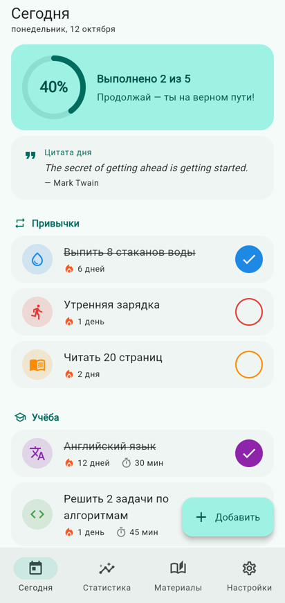 | 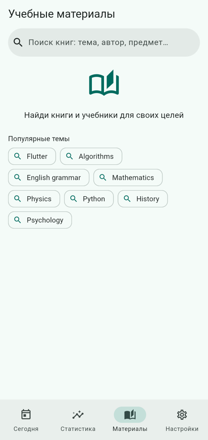 | 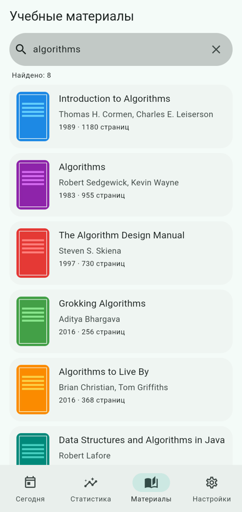 | 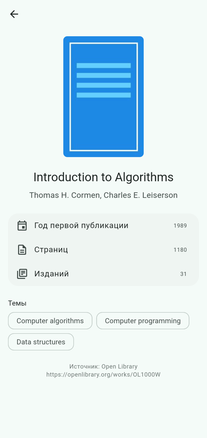 | 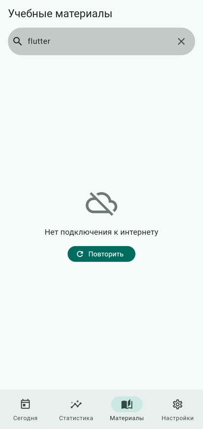 |

### Что сделано

- **dio** (`lib/core/network/dio_client.dart`): таймауты подключения/чтения,
  заголовки, логирование в debug-режиме.
- **Обработка ошибок:** `DioException` → доменные ошибки `Failure`
  (`NetworkFailure`, `TimeoutFailure`, `ServerFailure`, `ParsingFailure`) →
  понятный текст на экране («Нет подключения к интернету», «Сервер не отвечает»…).
- **JSON-сериализация через `json_serializable`:** DTO `BookDto`,
  `BookSearchResponseDto`, `QuoteDto` (файлы `*.g.dart` генерируются
  командой `dart run build_runner build --delete-conflicting-outputs`).
  DTO преобразуются в доменные сущности `Book`, `Quote`.
- **`MaterialsBloc`** — состояния `initial / loading / success / empty / failure`:
  - поиск с **debounce 400 мс** (`stream_transform`) + `restartable` — устаревшие запросы отбрасываются;
  - **pull-to-refresh** (`RefreshIndicator`);
  - **пагинация** — бесконечная прокрутка, `droppable` защищает от двойной загрузки;
  - ошибка подгрузки следующей страницы не стирает уже загруженный список.
- **`QuoteCubit`** — цитата дня на экране «Сегодня» (при ошибке карточка скрывается).
- Новые экраны: **Учебные материалы** и **Карточка книги** (с Hero-анимацией обложки).
- Тесты: разбор JSON (фикстура с реальным форматом ответа), маппинг ошибок
  через мок `Dio` (mocktail), `MaterialsBloc` (debounce, пустой результат,
  ошибка, пагинация, refresh), `QuoteCubit`, widget-тесты экрана поиска.

### Поток данных

```
SearchBar ──MaterialsQueryChanged──▶ MaterialsBloc ──(debounce 400мс)──▶ MaterialsRepository
                                          ▲                                   │
                                          │ MaterialsState                    ▼
ListView.builder ◀──── BlocBuilder ───────┘                      OpenLibraryApi (dio) ──▶ JSON ──▶ BookDto ──▶ Book
```

## 8. Неделя 6 — локальное хранение данных

### Что где хранится

| Данные | Хранилище | Файл |
|---|---|---|
| Тема и язык | **SharedPreferences** | `data/repositories/shared_prefs_settings_repository.dart` |
| Привычки и учебные цели, история выполнений | **Hive** (box `habits`) | `data/repositories/hive_habit_repository.dart` |
| Кэш ответов API (поиск книг, цитата дня) | **Hive** (box `api_cache`) | `data/datasources/local/materials_local_data_source.dart` |
| Избранные учебные материалы | **Hive** (box `favorites`) | `data/repositories/hive_favorites_repository.dart` |
| История поиска, служебные флаги | **Hive** (box `meta`) | там же |

Значения в Hive хранятся JSON-строками (модели на `json_serializable`), поэтому
не нужны TypeAdapter-ы и легко менять структуру данных.

### Стратегия offline-first

| Данные | Стратегия | Поведение без интернета |
|---|---|---|
| Цели и отметки | **Local-first**: источник правды — Hive | Работает полностью |
| Поиск книг | **Network-first + кэш**: ответ из сети сохраняется; при `NetworkFailure`/`TimeoutFailure` отдаётся кэш | Показывается кэш и плашка «Нет сети — показаны сохранённые результаты от …» |
| Цитата дня | **Cache-first**: в течение дня берётся из кэша, сеть — раз в день | Показывается последняя сохранённая |
| Избранное | Книга сохраняется целиком | Доступно полностью |

Ошибка сервера (5xx) кэшем **не** подменяется — пользователь должен знать, что сервер сломан.

### Скриншоты

| Сохранение книг | Тёмная тема сохранена | Перезапуск без сети | История поиска | Кэш без сети | Сохранённые |
|---|---|---|---|---|---|
| 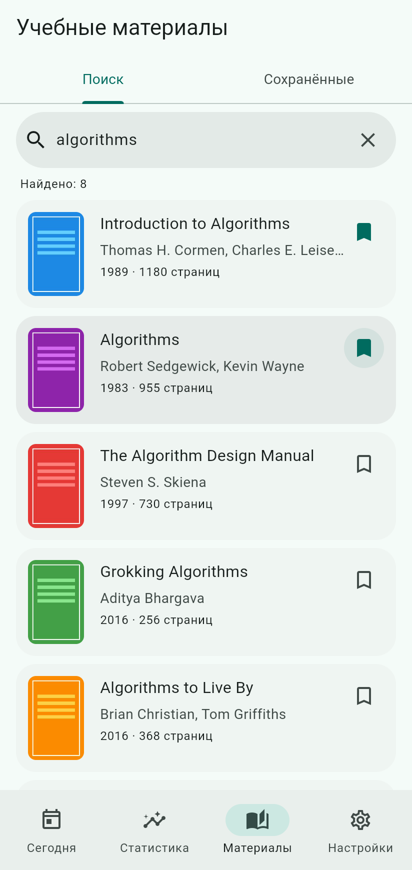 | 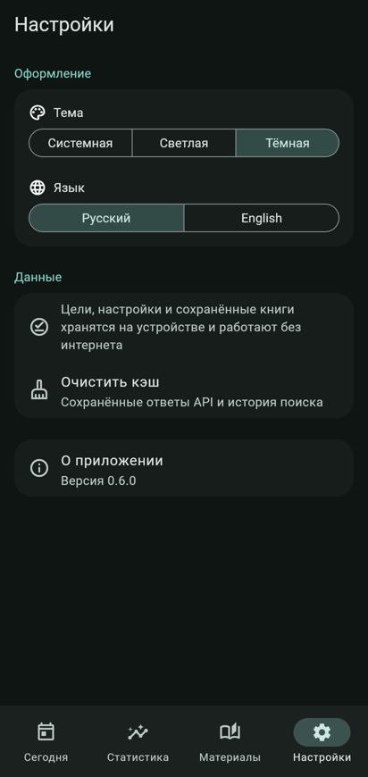 | 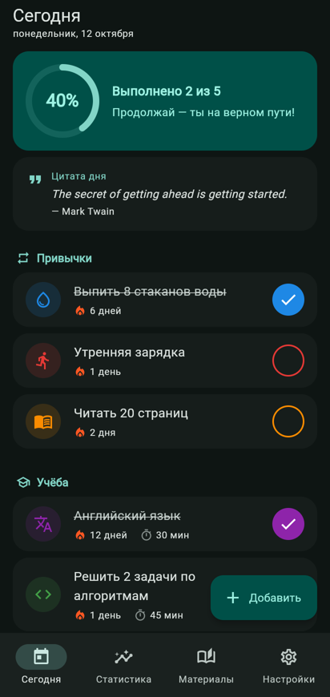 | 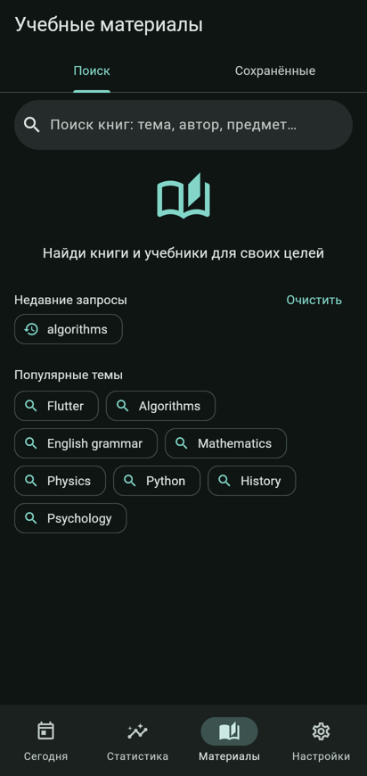 | 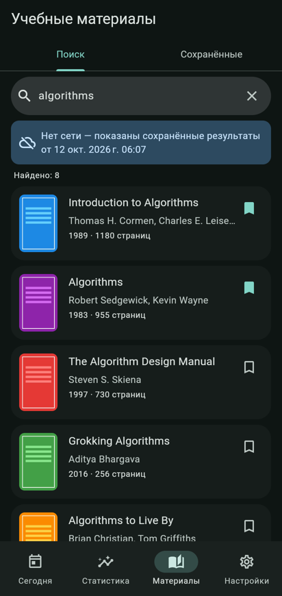 | 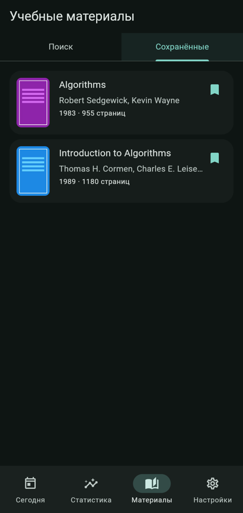 |

Сценарий на скриншотах: в первом запуске (с интернетом) выполнен поиск,
две книги добавлены в «Сохранённые», выбрана тёмная тема. Затем приложение
перезапущено **без интернета**: тема, цели, цитата дня, история поиска,
результаты поиска и сохранённые книги на месте.

### Что ещё сделано

- `InMemoryHabitRepository` заменён на `HiveHabitRepository` — BLoC и экраны
  не изменились (сработал паттерн Repository + DI).
- При первом запуске добавляются демо-цели (только один раз).
- Вкладки «Поиск / Сохранённые», закладка на карточке книги (`FavoritesCubit`).
- «Очистить кэш» в настройках.
- Язык по умолчанию — язык устройства (если это русский или английский).
- Тесты: Hive-репозитории во временной папке (в т.ч. «перезапуск» — закрытие
  и повторное открытие коробок), SharedPreferences, offline-сценарии
  репозитория материалов, история поиска, избранное.

## 9. Доменная модель (расширение по ТЗ)

До недели 6 модель была упрощённой: у цели был список выполненных дней.
Перед неделей 7 модель доведена до ТЗ — без неё не сделать вкладки
«Привычки» и «Цели» и модуль геймификации.

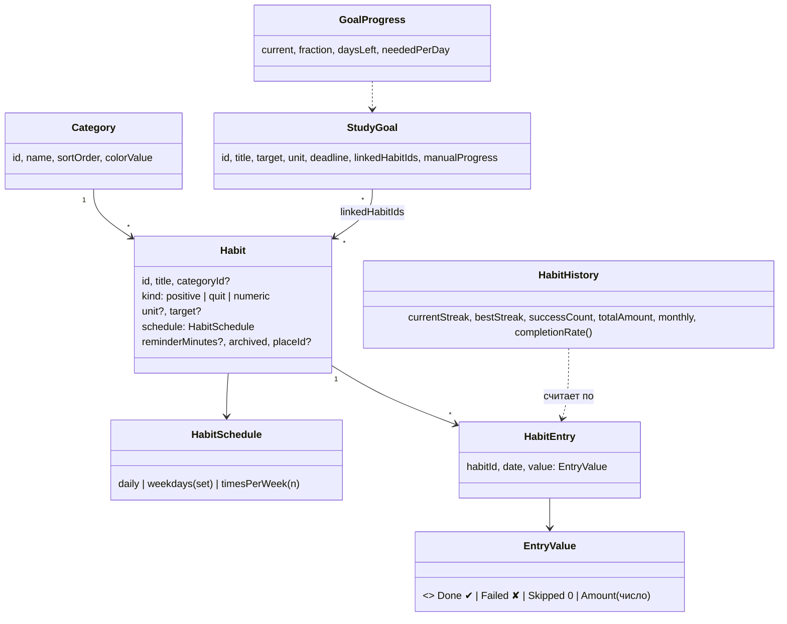

### Правила отметок и серий

| Значение | Обычная привычка | Отказ от вредного | Серия |
|---|---|---|---|
| ✔ | выполнил | удержался | +1 |
| ✘ | не выполнил | сорвался | **обрывает** |
| 0 | пропуск | пропуск | не влияет |
| пусто (нет записи) | — | — | не влияет |
| число > 0 (числовая) | выполнено | — | +1 |

- Записи создаются **только** для отмеченных дней — пустые дни не хранятся.
- `HabitHistory` (domain) считает текущую и лучшую серию, дни выполнения,
  сумму для числовых привычек, итоги по месяцам и процент выполнения.
- Прогресс учебной цели (`GoalProgress`): ручная поправка + сумма значений
  привязанных числовых привычек (или число ✔ для обычных) с даты создания цели.

### Хранение

- Привычки, отметки, категории и цели — отдельные коллекции Hive
  (`LocalCollection`). Отметка за день — маленький отдельный документ
  `habitId|yyyy-MM-dd`, поэтому нажатие ✔ не перезаписывает всю привычку.
- У каждой записи есть `updatedAt` и флаг удаления — это понадобится для
  синхронизации с Firestore (неделя 8).
- **Миграция:** данные старого формата (недели 4–6) при первом запуске
  переносятся в новый (`LocalBootstrap.migrateLegacy`, покрыто тестом).

### Интерфейс

- «Сегодня» группирует привычки по категориям; нажатие на кружок — ✔,
  долгое нажатие — выбор ✔ / ✘ / 0 / число; числовая привычка — ввод числа.
- Детали привычки: текущая/лучшая серия, дни выполнения, срывы, сумма,
  календарь (можно отметить прошедший день), тепловая карта за 20 недель,
  таблица и полоски по месяцам, архивирование.

## 10. Модуль «Геймификация» (скрыт по умолчанию)

В настройках есть флаг «Включить геймификацию» (SharedPreferences,
по умолчанию **выключен**). Пока он выключен, в интерфейсе нет ни одного
упоминания метрик.

**Доменная логика** — `lib/domain/services/metric_calculator.dart`
(чистая функция, 14 unit-тестов в `test/domain/metric_calculator_test.dart`):

| | Пропорциональный (пресет Power, %) | Абсолютный (пресет Money, тг) |
|---|---|---|
| Прирост за день | `лимит × очки / максимум возможных очков` | `MIN(лимит, сумма наград)` |
| Потеря за день | `MIN(лимит потери, сумма штрафов за ✘)` | то же |
| Пресет | +1% / −50% в день, старт 0% | +300 000 / −1 000 000 в день, старт 0 |

- **Очки дня** — сумма наград привязанных привычек, отмеченных ✔ (или числом > 0).
- **Максимум возможных очков** — сумма наград привычек, которые в этот день
  отмечены ✔/✘/числом или запланированы, но не отмечены. Пропуск (0)
  в максимум не входит — он ни на что не влияет.
- **Значение** = старт + Σ(прирост − потеря) по всем дням; может быть отрицательным.
- Связь привычка → метрика (`HabitMetricRule`: награда за ✔, штраф за ✘)
  **необязательна**; одна привычка может влиять на несколько метрик.
- Значения не хранятся, а считаются из отметок (`MetricsCubit` пересчитывает
  при любом изменении метрик, связей, привычек или отметок) — поэтому
  **при изменении весов история пересчитывается автоматически**.

### Интерфейс модуля (после недели 7)

- **Настройки** → переключатель «Включить геймификацию».
- **Профиль → Метрики** (`/profile/metrics`): список метрик с текущим значением
  и изменением за сегодня; создание своей метрики или по пресету Power / Money;
  маршрут защищён redirect-ом — при выключенном модуле недоступен даже по ссылке.
- **Экран метрики**: значение, график (`CustomPainter`), влияющие привычки,
  история по дням — вклад, прирост, потеря, итог и значение на конец дня.
- **Настройки привычки** → свёрнутый блок «Влияние на метрики»: для каждой
  метрики переключатель, награда за ✔ и штраф за ✘ + подсказка
  «терять должно быть легче, чем набирать».
- **Плашка** с текущими значениями — на «Сегодня» и в окне отметки дня.

| Сегодня с плашкой | Метрики | Метрика: график и история | Новая метрика (пресеты) | Влияние на метрики |
|---|---|---|---|---|
| 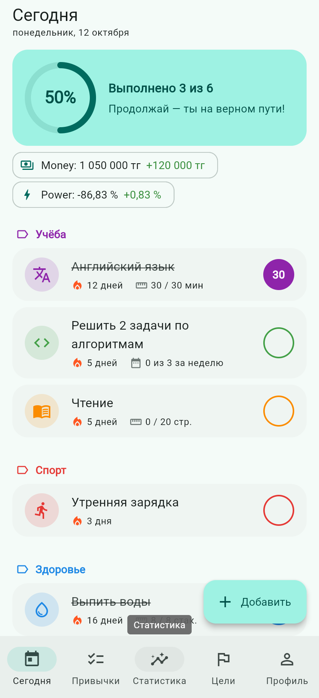 | 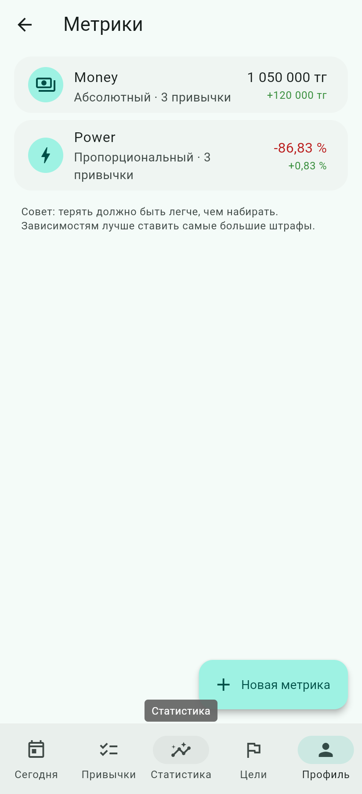 | 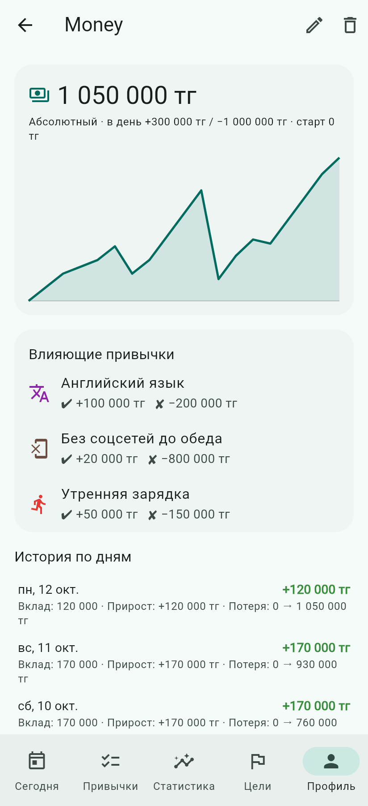 | 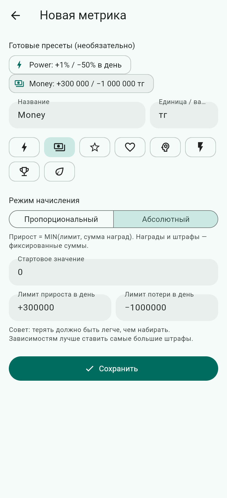 | 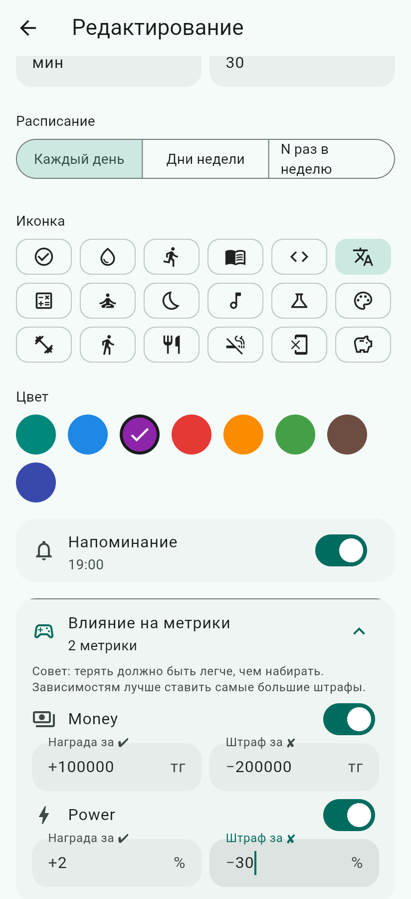 |

## 11. Неделя 7 — навигация (GoRouter) и адаптивный интерфейс

### Карта маршрутов

```
/login                         вход / регистрация / гость           (публичный)
StatefulShellRoute (5 вкладок, у каждой свой стек):
  /today                       Сегодня
  /habits                      Привычки
    /habits/categories         Категории (внутри вкладки)
  /stats                       Статистика
  /goals                       Цели
    /goals/new                 новая цель          (поверх навигации)
    /goals/:goalId             детали цели         (внутри вкладки)
      /goals/:goalId/edit      редактирование      (поверх навигации)
  /profile                     Профиль
    /profile/settings          Настройки (внутри вкладки)
/habit/new?category=…          новая привычка (query-параметр)
/habit/:id                     детали привычки (path-параметр)
  /habit/:id/edit              редактирование
/materials?q=…                 поиск учебных материалов
  /materials/book              карточка книги (объект через extra)
```

- **Именованные маршруты**: `context.pushNamed(AppRoutes.habit, pathParameters: {'id': id})`
  — путь меняется в одном месте (`lib/presentation/router/app_router.dart`).
- **Параметры**: path (`:id`, `:goalId`), query (`?q=`, `?category=`), объект (`extra: book`).
- **Вложенная навигация**: `StatefulShellRoute.indexedStack` — у каждой вкладки
  свой `Navigator`; при переключении вкладок стек сохраняется, повторное
  нажатие на вкладку возвращает к её началу.
- **Защита маршрутов (redirect)**: функция `authRedirect` — не вошёл →
  `/login?from=<куда шёл>`, после входа — обратно. `refreshListenable`
  слушает поток авторизации, поэтому вход/выход сразу меняют экран.
- **Авторизация** — интерфейс `AuthRepository`; на неделе 7 реализация
  `LocalAuthRepository` (гостевой режим, флаг в SharedPreferences),
  на неделе 8 — Firebase. Роутер и экраны при замене не меняются.
- `errorBuilder` — экран «Страница не найдена» для неизвестного адреса.

### Адаптивная вёрстка

| Класс ширины (Material 3) | Пример | Навигация | Раскладка |
|---|---|---|---|
| compact < 600 | телефон, портрет | `NavigationBar` снизу | одна колонка |
| medium 600–839 | телефон, альбом | `NavigationRail` | «Сегодня»: прогресс слева, список справа |
| expanded ≥ 840 | планшет | `NavigationRail` (с подписями ≥ 1200) | «Привычки»: список + детали (master-detail); детали — 2 колонки; цели — 2–3 колонки |

- `context.windowSize` (`lib/core/layout/breakpoints.dart`) использует
  `MediaQuery.sizeOf` — виджет перестраивается только при смене размера.
- Формы и экран входа ограничены по ширине (`ConstrainedBox`), календарь
  не растягивается на широком экране.
- Виджет-тесты проверяют три размера экрана: телефон, альбомная ориентация,
  планшет (`test/presentation/navigation_test.dart`).

### Новые экраны

Вход, Привычки (с архивом), Категории (создать / переименовать / перетащить /
удалить), Учебные цели, Детали цели, Создание цели (дедлайн, привязка
привычек, книга из «Сохранённых»), Профиль.

### Скриншоты

| Вход (без Firebase) | Сегодня | Привычки | Детали привычки | Цели | Детали цели |
|---|---|---|---|---|---|
| 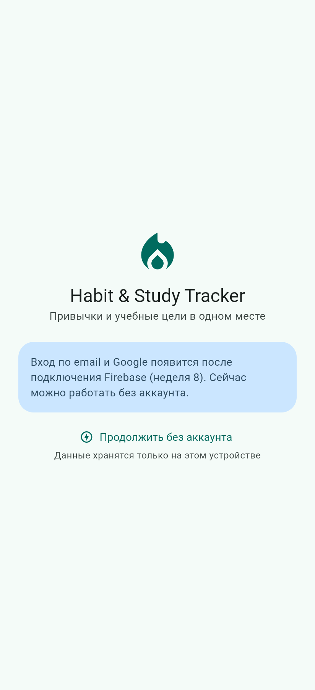 | 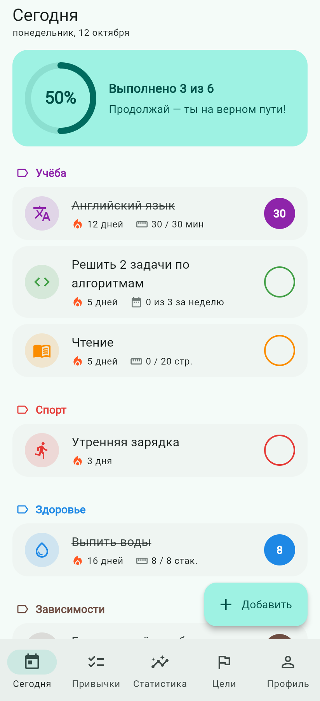 | 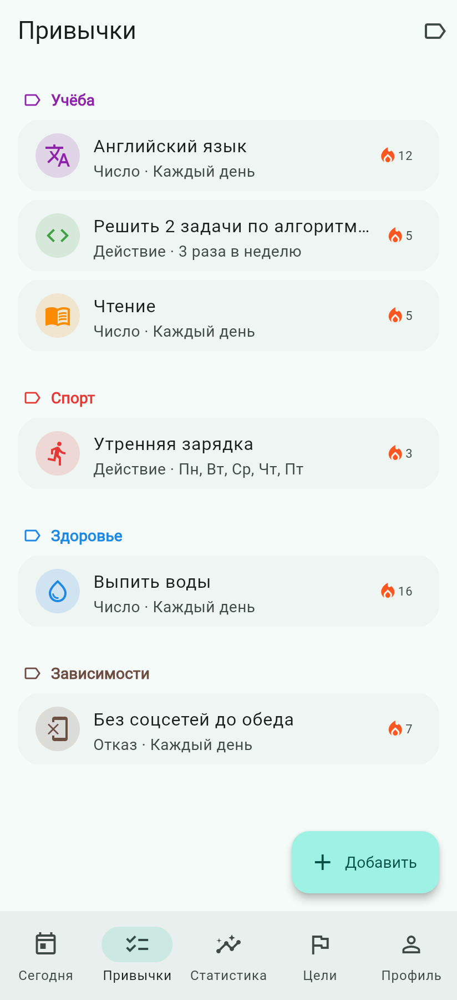 | 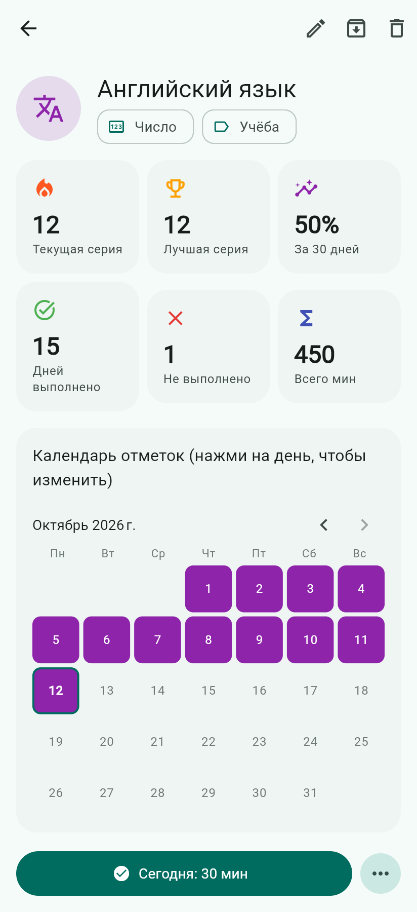 | 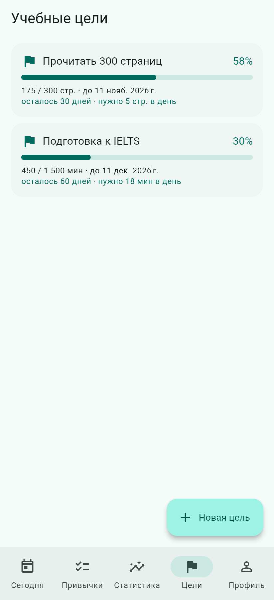 | 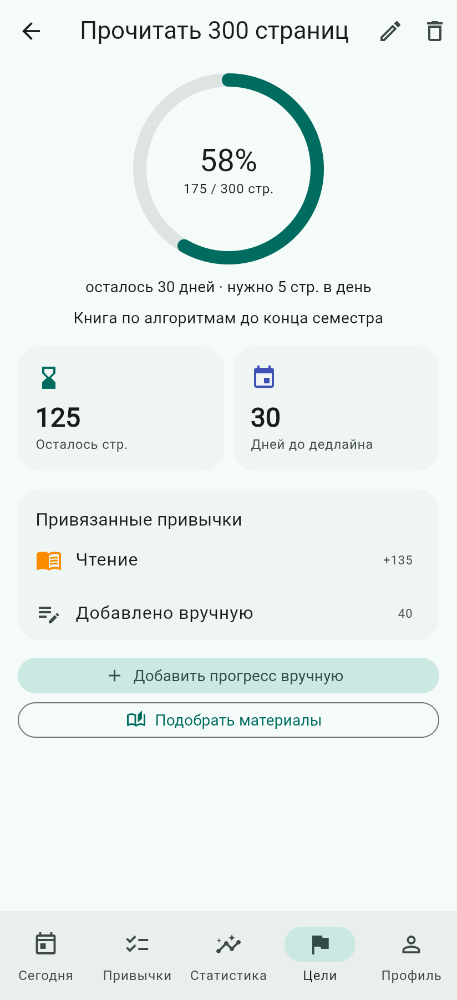 |

| Альбомная ориентация | Планшет: список + детали | Планшет, тёмная тема |
|---|---|---|
| 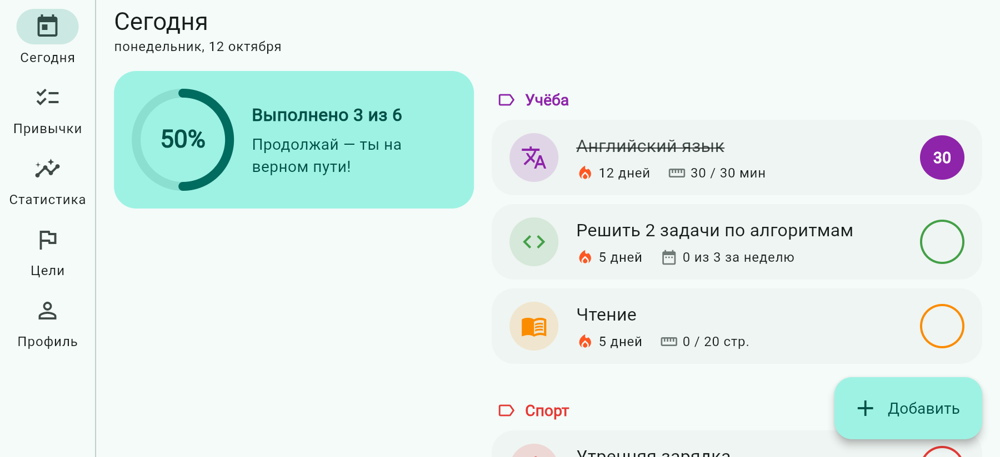 | 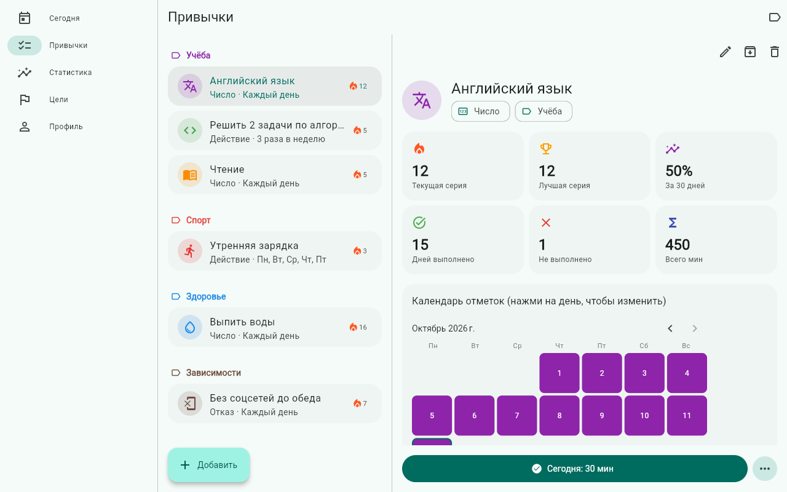 | 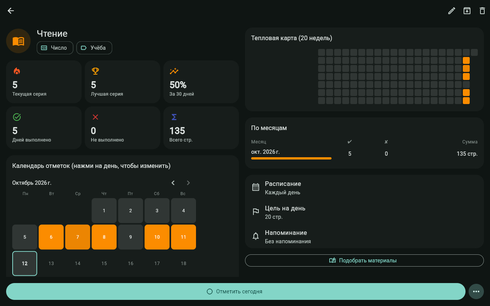 |

## 12. План по неделям

| Неделя | Тема | Статус |
|---|---|---|
| 1 | Введение во Flutter и Dart | ✅ |
| 2 | Виджеты и построение UI | ✅ |
| 3 | Управление состоянием: setState → InheritedWidget → Provider | ✅ |
| 4 | BLoC, слои, Repository, DI | ✅ |
| 5 | REST API и JSON | ✅ |
| 6 | Локальное хранение данных | ✅ |
| 7 | GoRouter, адаптивный интерфейс | ✅ |
| 8 | Firebase: Auth, Firestore, FCM | ⏳ |
| 9 | Google Maps, геолокация (места для учёбы рядом) | ⏳ |
| 10 | Производительность, DevTools | ⏳ |
| 11 | Камера/датчики, Platform Channel (Kotlin) | ⏳ |
| 12 | CI/CD (GitHub Actions) | ⏳ |
| 13 | Тестирование, покрытие > 40% | ⏳ (уже ~87%) |
| 14 | Release-сборка, Crashlytics | ⏳ |

Шпаргалка по коду для защиты: [`docs/defense_guide.md`](docs/defense_guide.md).
