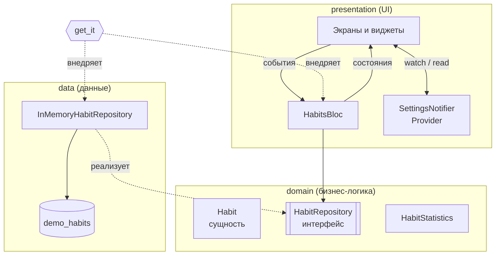

# Habit & Study Tracker

Кроссплатформенное мобильное приложение на **Flutter/Dart** для отслеживания
привычек и учебных целей: серии (streaks), статистика, напоминания.

> Тема №3 курса «Разработка мобильных приложений на Flutter».

## 1. Постановка задачи

### Цель

Помочь студентам и всем, кто учится самостоятельно, выработать полезные
привычки и регулярно заниматься учёбой. Приложение позволяет:

- создавать **привычки** («пить воду», «зарядка») и **учебные цели**
  («30 минут английского», «решить 5 задач по алгоритмам»);
- ежедневно отмечать выполнение одним нажатием;
- видеть **серию** — сколько дней подряд цель выполняется, и лучшую серию;
- смотреть **статистику** за неделю / месяц;
- получать **напоминания** в выбранное время;
- находить **учебные материалы** (книги) через открытый API и сохранять их.

### Целевая аудитория

- Студенты колледжей и вузов (17–25 лет), которым нужно систематически
  готовиться к занятиям и экзаменам.
- Школьники старших классов, готовящиеся к ЕНТ/IELTS.
- Люди, изучающие что-то самостоятельно (языки, программирование).

### Аналоги

| Приложение | Что нравится | Чего не хватает |
|---|---|---|
| **Loop Habit Tracker** | Простой, бесплатный, хорошая статистика | Нет учебных целей и материалов, устаревший дизайн |
| **Habitica** | Геймификация, сообщество | Перегружен интерфейс, сложен для новичка |
| **Forest** | Фокус на учёбе (таймер) | Нет привычек и серий по дням, платный |

**Отличие нашего приложения:** объединяет привычки и учебные цели в одном
месте и сразу подсказывает учебные материалы по теме цели.

### Список экранов

1. **Сегодня (Home)** — список привычек и целей на сегодня, отметка выполнения,
   прогресс дня, мотивационная цитата.
2. **Детали цели** — серия, лучшая серия, календарь выполнений за месяц.
3. **Создание / редактирование цели** — название, тип (привычка / учёба),
   иконка, цвет, дни недели, время напоминания.
4. **Статистика** — процент выполнения за неделю, график по дням,
   лидеры по сериям.
5. **Учебные материалы** — поиск книг через Open Library API,
   сохранение в «избранное».
6. **Карточка книги** — обложка, авторы, год, темы.
7. **Настройки** — тема (светлая / тёмная / системная), язык, уведомления.
8. **Вход / регистрация** — Firebase Authentication (неделя 8).
9. **Карта** — места для учёбы рядом (библиотеки, коворкинги) (неделя 9).

### MVP (минимально жизнеспособный продукт)

- [ ] CRUD привычек и учебных целей
- [ ] Отметка выполнения за день, подсчёт текущей и лучшей серии
- [ ] Статистика за 7 дней
- [ ] Поиск учебных материалов через REST API
- [ ] Светлая / тёмная тема, хранение настроек
- [ ] Офлайн-работа (локальная БД)
- [ ] Напоминания (push / локальные уведомления)

## 2. Как запустить

```bash
flutter doctor        # проверка окружения
flutter pub get       # установка зависимостей
flutter run           # запуск на эмуляторе / устройстве
flutter test          # запуск тестов
flutter analyze       # статический анализ
```

## 3. Задачи на Dart (неделя 1)

Папка [`dart_tasks/`](dart_tasks) — небольшие задачи по основам Dart:

| Файл | Тема |
|---|---|
| `task1_null_safety.dart` | null safety: `?`, `??`, `?.`, `!`, `late` |
| `task2_classes.dart` | классы, абстрактные классы, наследование, enum, mixin |
| `task3_collections.dart` | List, Set, Map, records, `map/where/fold`, подсчёт серии |
| `task4_async.dart` | `Future`, `async/await`, `Stream`, `Future.wait`, таймаут, ошибки |

Запуск: `dart run dart_tasks/task3_collections.dart`.
Тесты к задачам: `flutter test test/dart_tasks_test.dart`.

## 4. Неделя 2 — виджеты и UI

### Эскизы экранов


Исходник эскизов — [`docs/sketches/wireframes.svg`](docs/sketches/wireframes.svg).

### Скриншоты (статические данные)

| Сегодня | Детали | Статистика | Тёмная тема |
|---|---|---|---|
|  |  |  |  |

### Что сделано

- 5 экранов: **Сегодня**, **Детали цели**, **Создание цели**, **Статистика**, **Настройки**
  + нижняя навигация (`NavigationBar` + `IndexedStack`).
- `StatelessWidget` — экраны, которые только отображают данные
  (`TodayScreen`, `HabitDetailScreen`, `StatisticsScreen`).
- `StatefulWidget` — `HomeShell` (выбранная вкладка) и `HabitEditScreen` (состояние формы).
- Использованы `Row`, `Column`, `Stack` (круговой прогресс с процентом внутри),
  `ListView`, `GridView` (календарь), `Wrap`, `Card`, `ListTile`, `SegmentedButton`,
  `FilterChip`, `Slider`, `Switch`, `showTimePicker`, `AnimatedContainer`.
- Тема **Material 3** (`ColorScheme.fromSeed`), светлая и тёмная, переключается по системе.
- Локализация через `flutter gen-l10n` (ARB-файлы `lib/l10n/app_ru.arb`, `app_en.arb`),
  включая правильные формы множественного числа («1 день», «3 дня», «5 дней»).
- Модель `Habit` с логикой подсчёта серии, лучшей серии и процента выполнения + unit-тесты.

### Структура проекта (неделя 2, до разделения на слои)

```
lib/
├── main.dart              # точка входа
├── app.dart               # MaterialApp: темы, локализация
├── data/mock_habits.dart  # статические данные
├── l10n/                  # ARB-файлы и сгенерированная локализация
├── models/habit.dart      # модель привычки/учебной цели
├── screens/               # экраны
├── theme/app_theme.dart   # тема Material 3, отступы
├── utils/date_utils.dart  # работа с датами
└── widgets/               # переиспользуемые виджеты
```

## 5. Неделя 3 — управление состоянием (базовые подходы)

**Ключевая функция:** отметка выполнения за день, создание, редактирование
и удаление целей. Реализована трижды (отдельные коммиты):
`setState` → `InheritedWidget` → `Provider`.

Подробно с примерами кода: [`docs/week3_state_management.md`](docs/week3_state_management.md).

| | setState | InheritedWidget | Provider |
|---|---|---|---|
| Плюсы | Просто, встроено, нет зависимостей | Доступ из любого места дерева, встроено во Flutter | Мало кода, `watch/read/select`, логика отделена от UI и тестируется unit-тестами |
| Минусы | Prop drilling, дублирование копий данных, логика смешана с UI | Много шаблонного кода, легко ошибиться с подпиской | Внешняя зависимость; для сложной асинхронной логики не хватает структуры |
| Когда применять | Локальное состояние виджета (форма, вкладка, анимация) | Раздача редко меняющихся данных (как `Theme.of`) | Простое общее состояние: настройки, тема, избранное |

## 6. Неделя 4 — продвинутое управление состоянием и архитектура

### Архитектура по слоям



- **domain** — чистый Dart, не зависит от Flutter и от способа хранения:
  сущность `Habit` (подсчёт серий), интерфейс `HabitRepository`,
  сервис `HabitStatistics`.
- **data** — реализации репозиториев. Сейчас `InMemoryHabitRepository`;
  на неделе 6 появится реализация на Hive, а на неделе 8 — Firestore.
- **presentation** — экраны, виджеты, `HabitsBloc` и `SettingsNotifier`.
- **Dependency Injection** — `get_it` (`lib/core/di/injection.dart`).
  BLoC получает репозиторий через конструктор, поэтому в тестах вместо
  настоящего репозитория легко подставить мок (`mocktail`).

### Почему BLoC для основной логики, а Provider — для настроек

| Критерий | BLoC (`flutter_bloc`) | Provider (`ChangeNotifier`) |
|---|---|---|
| Где используется | Список целей, отметки, удаление/отмена, загрузка из репозитория | Тема и язык |
| Явные события | ✅ `HabitToggled`, `HabitSaved`, `HabitDeleted`… — видно, что может произойти | ❌ методы вызываются напрямую |
| Асинхронность и потоки | ✅ `emit.forEach` для `Stream` из репозитория, обработка ошибок | Нужно писать вручную |
| Состояния loading / success / failure | ✅ явный `HabitsStatus` | Флаги вручную |
| Тестирование | ✅ `bloc_test`: «событие → ожидаемые состояния» | ✅ unit-тесты, но без готового DSL |
| Объём кода | Больше (event, state, bloc) | Минимум |

**Вывод:** логика целей — центральная, асинхронная и будет расти
(Hive, сеть, Firestore), поэтому для неё выбран **BLoC** — он даёт
предсказуемый однонаправленный поток данных и удобное тестирование.
Настройки — простое синхронное состояние, для него BLoC избыточен,
поэтому оставлен **Provider**.

### Поток данных на примере отметки цели

1. Пользователь нажимает на кружок → `context.read<HabitsBloc>().add(HabitToggled(id, today))`.
2. `HabitsBloc` находит цель, вызывает `habit.toggleDay(today)` и `repository.saveHabit(...)`.
3. Репозиторий отдаёт новый список в поток `watchHabits()`.
4. `emit.forEach` превращает его в новое `HabitsState` → `BlocBuilder` перерисовывает экраны.

### Структура проекта (неделя 4)

```
lib/
├── main.dart                      # configureDependencies() + runApp
├── app.dart                       # BlocProvider, ChangeNotifierProvider, MaterialApp
├── core/
│   ├── di/injection.dart          # get_it
│   ├── theme/app_theme.dart
│   └── utils/date_utils.dart
├── domain/
│   ├── entities/habit.dart
│   ├── repositories/habit_repository.dart
│   └── services/habit_statistics.dart
├── data/
│   ├── datasources/demo_habits.dart
│   └── repositories/in_memory_habit_repository.dart
├── presentation/
│   ├── blocs/habits/              # habits_bloc.dart, habits_event.dart, habits_state.dart
│   ├── providers/settings_notifier.dart
│   ├── screens/
│   └── widgets/
└── l10n/
```

## 7. Неделя 5 — REST API и JSON

### Источники данных

| API | Что берём | Запрос |
|---|---|---|
| [Open Library Search](https://openlibrary.org/dev/docs/api/search) (бесплатно, без ключа) | Учебные материалы: книги по теме цели | `GET https://openlibrary.org/search.json?q=algorithms&page=1&limit=20&fields=...` |
| Open Library Covers | Обложки книг | `GET https://covers.openlibrary.org/b/id/{cover_i}-M.jpg` |
| [DummyJSON Quotes](https://dummyjson.com/docs/quotes) | Мотивационная «цитата дня» | `GET https://dummyjson.com/quotes/random` |

**Почему Open Library:** приложение про учёбу — к каждой учебной цели можно
подобрать книги. На экране учебной цели есть кнопка **«Подобрать материалы»**,
которая открывает поиск по названию цели.

### Скриншоты

| Цитата дня | Поиск: начальное состояние | Результаты | Книга | Нет интернета |
|---|---|---|---|---|
|  |  |  |  |  |

### Что сделано

- **dio** (`lib/core/network/dio_client.dart`): таймауты подключения/чтения,
  заголовки, логирование в debug-режиме.
- **Обработка ошибок:** `DioException` → доменные ошибки `Failure`
  (`NetworkFailure`, `TimeoutFailure`, `ServerFailure`, `ParsingFailure`) →
  понятный текст на экране («Нет подключения к интернету», «Сервер не отвечает»…).
- **JSON-сериализация через `json_serializable`:** DTO `BookDto`,
  `BookSearchResponseDto`, `QuoteDto` (файлы `*.g.dart` генерируются
  командой `dart run build_runner build --delete-conflicting-outputs`).
  DTO преобразуются в доменные сущности `Book`, `Quote`.
- **`MaterialsBloc`** — состояния `initial / loading / success / empty / failure`:
  - поиск с **debounce 400 мс** (`stream_transform`) + `restartable` — устаревшие запросы отбрасываются;
  - **pull-to-refresh** (`RefreshIndicator`);
  - **пагинация** — бесконечная прокрутка, `droppable` защищает от двойной загрузки;
  - ошибка подгрузки следующей страницы не стирает уже загруженный список.
- **`QuoteCubit`** — цитата дня на экране «Сегодня» (при ошибке карточка скрывается).
- Новые экраны: **Учебные материалы** и **Карточка книги** (с Hero-анимацией обложки).
- Тесты: разбор JSON (фикстура с реальным форматом ответа), маппинг ошибок
  через мок `Dio` (mocktail), `MaterialsBloc` (debounce, пустой результат,
  ошибка, пагинация, refresh), `QuoteCubit`, widget-тесты экрана поиска.

### Поток данных

```
SearchBar ──MaterialsQueryChanged──▶ MaterialsBloc ──(debounce 400мс)──▶ MaterialsRepository
                                          ▲                                   │
                                          │ MaterialsState                    ▼
ListView.builder ◀──── BlocBuilder ───────┘                      OpenLibraryApi (dio) ──▶ JSON ──▶ BookDto ──▶ Book
```

## 8. План по неделям

| Неделя | Тема | Статус |
|---|---|---|
| 1 | Введение во Flutter и Dart | ✅ |
| 2 | Виджеты и построение UI | ✅ |
| 3 | Управление состоянием: setState → InheritedWidget → Provider | ✅ |
| 4 | BLoC, слои, Repository, DI | ✅ |
| 5 | REST API и JSON | ✅ |
| 6 | Локальное хранение данных | ⏳ |
